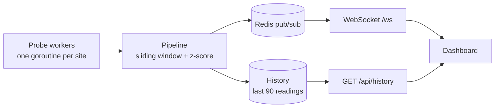

# Telemetry Pulse

Telemetry Pulse checks a few websites every 10 seconds, learns what a normal response time looks like for each one, and flags readings that are unusually slow. Every reading streams live to a small dashboard.

Backend in Go, Redis pub/sub in the middle, plain HTML/CSS/JS on the front.

## How it works



- **Probing.** Each site gets its own goroutine. A probe times how long the response headers take to arrive, so DNS, connect, TLS and redirects are included. The body is never downloaded, which keeps bandwidth tiny.
- **Baseline.** Each site keeps a window of its last 100 good readings. The mean and standard deviation come from running sums, so adding a reading is O(1) no matter how big the window is.
- **Spikes.** A reading is a spike when its z-score is above 3 *and* it is at least 20 ms slower than normal. Nothing is flagged until a site has 20 readings. A spike goes into the window capped at mean + 3σ, so one 5 second timeout doesn't hide the next problem.
- **Down.** Failed requests and 4xx/5xx responses are reported as down with a reason (timeout, connection refused, HTTP 404...) and kept out of the baseline. Otherwise a dead site would look like the fastest one, since errors come back in about a millisecond.
- **Live updates.** Every reading is published on Redis and pushed to browsers over a WebSocket. The last 15 minutes are also kept in memory and served on `/api/history`, so the page has charts as soon as it opens.

## Run it locally

You need Go 1.26+ and Redis.

```sh
redis-server --daemonize yes
cd backend
go run .
```

Then open http://localhost:8080. Run the tests with `go test ./...` from `backend/`.

## Configuration

All optional, set as environment variables.

| Variable | Default | |
| --- | --- | --- |
| `TARGETS` | google.com, github.com, silvershinehouse.com | Comma separated URLs to check |
| `PROBE_INTERVAL` | `10s` | Time between checks, minimum `1s` |
| `PORT` | `8080` | HTTP port |
| `REDIS_URL` | `redis://localhost:6379/0` | Use `rediss://` for TLS |
| `STATIC_DIR` | `../frontend` | Folder the dashboard is served from |
| `ALLOWED_ORIGINS` | none | Extra origins allowed to open `/ws`, for a frontend running on another port |

## Endpoints

- `GET /` the dashboard
- `GET /api/history` last 90 readings per site
- `GET /ws` WebSocket, one JSON message per reading
- `GET /health` returns `ok`

A reading looks like this:

```json
{"url":"https://github.com","latency_ms":53.27,"status":200,"ok":true,"zscore":3.62,"baseline_ms":41.2,"anomaly":true,"timestamp":1793025927894}
```

## Deploying

The `Dockerfile` builds the server and runs Redis inside the same container (`start.sh`), so one service is enough. On Render: create a Web Service from this repo, choose Docker, and set the health check path to `/health`. If you'd rather use a hosted Redis, set `REDIS_URL` and the container won't start its own.

Free hosting tiers usually put idle apps to sleep, which stops the probes. Pointing a free uptime checker at `/health` every 10 minutes keeps it awake.

## Project layout

```
backend/
  main.go                  wiring, HTTP server, graceful shutdown
  internal/probe           HTTP probe workers
  internal/window          O(1) sliding window (mean, stddev, z-score)
  internal/anomaly         per-site spike detection
  internal/engine          pipeline, reading format, in-memory history
  internal/pubsub          Redis publish/subscribe
  internal/wsserver        WebSocket endpoint
  internal/config          environment variables
frontend/                  dashboard (index.html, style.css, app.js)
Dockerfile, start.sh       container build
```
